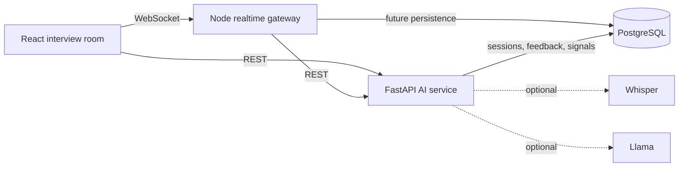

# AI Interview Platform

A starter implementation for a LeetCode + Interviewing.io style product: live coding, AI interviewer prompts, speech transcription hooks, emotion signals, coding hints, interview feedback, and candidate history.

## Apps

- `apps/web`: React + Vite interview room UI.
- `apps/realtime`: Node WebSocket gateway for interview events, WebRTC signaling, editor sync, and AI requests.
- `services/ai`: FastAPI service for interviewer turns, hints, transcription, emotion analysis, and feedback.
- `infra/db`: PostgreSQL schema for candidates, sessions, code snapshots, events, feedback, and metrics.

## Quick Start

```bash
npm install
python3 -m venv services/ai/.venv
services/ai/.venv/bin/pip install -r services/ai/requirements.txt
docker compose up -d postgres
npm run dev
services/ai/.venv/bin/uvicorn main:app --app-dir services/ai --reload
```

Open [http://localhost:5173](http://localhost:5173).

## Architecture



The current AI service uses deterministic local responses so the platform is runnable immediately. Replace the service internals in `services/ai/main.py` with Whisper and Llama calls when local models or hosted inference are available.
